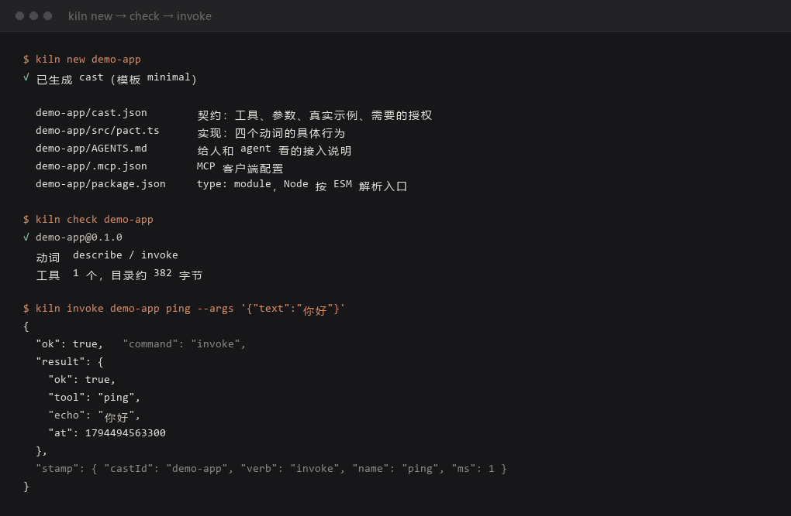
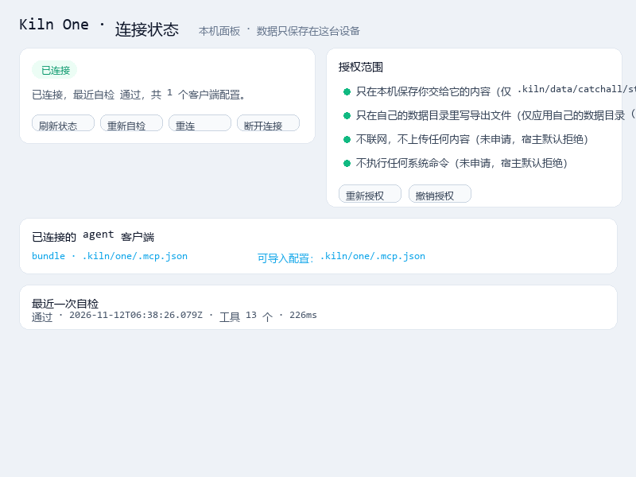
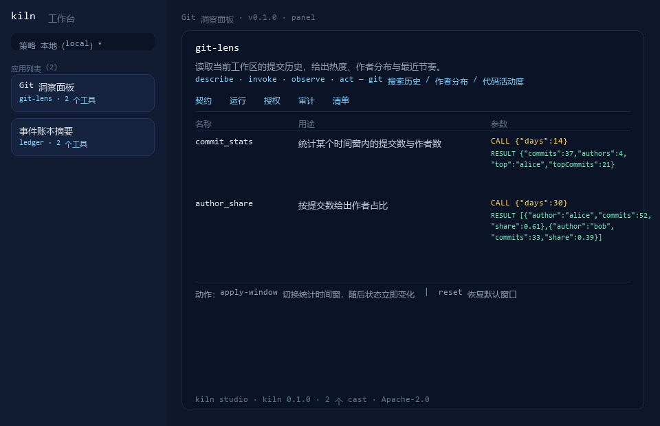
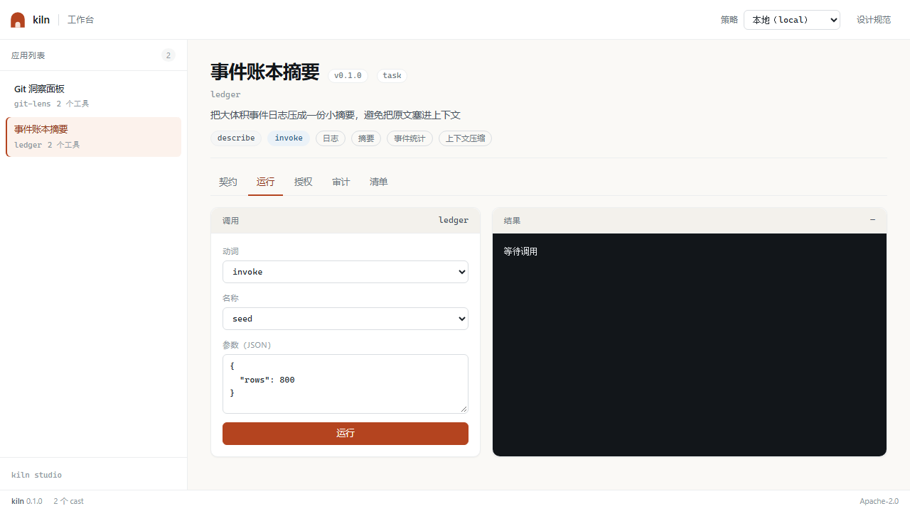
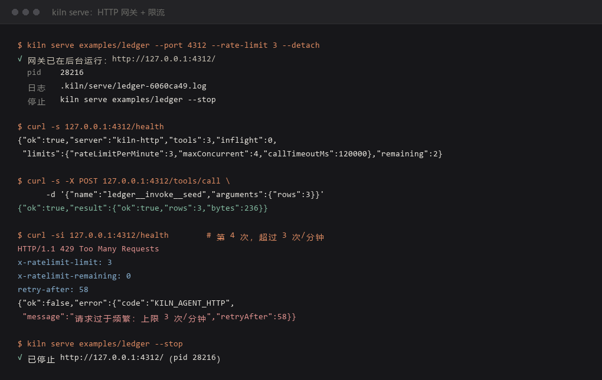
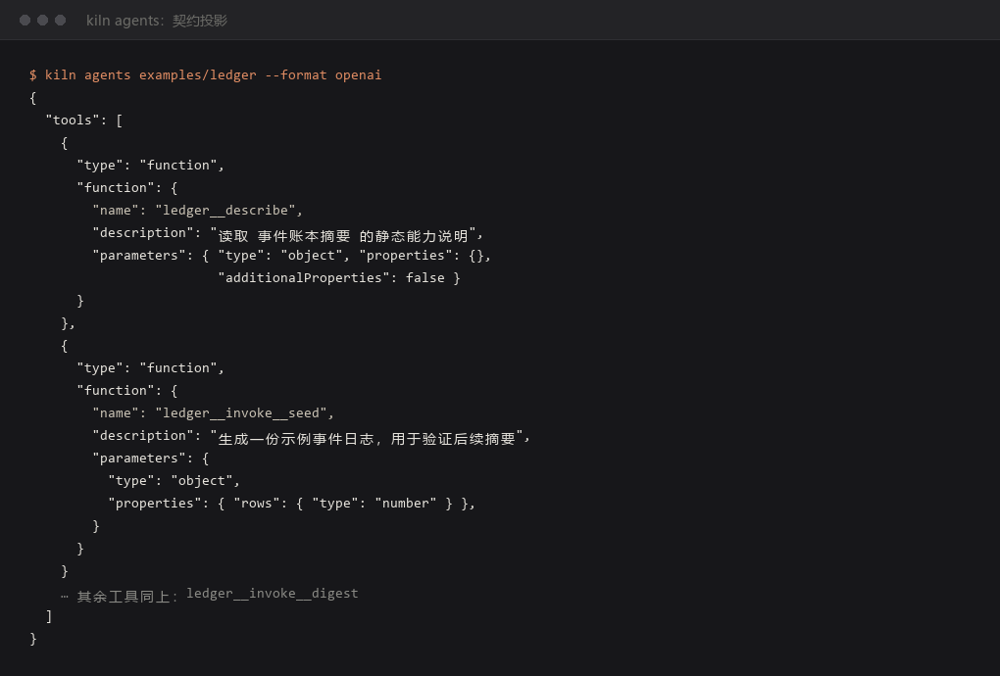
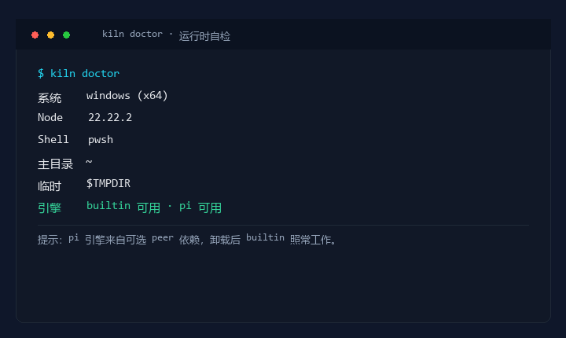

<p align="center">
  
</p>

<p align="center">
  给 AI 助手补上「记住东西、翻旧账、做汇总」的能力。
</p>

<p align="center">
  Apache-2.0 · Node.js ≥ 22.18 · 运行时零依赖
</p>

---

**Kiln 是一个本地小工具集。** 它把「存一下、帮我找、今天要做什么、这周汇总」这几件小事，做成 agent 能直接调用的工具；数据存在你自己的电脑上，不经过云端。

它具体能做四件事：

- **存**：截图里的文字、链接、待办、发票、地址……一句话交给 agent，自动去重、分类、落到本地。
- **找**：说「上个月的房租发票」，只回几条命中加片段，不把整个库塞进 AI 的上下文。
- **问**：每天早上问「今天要做什么」，返回 2 KB 以内的摘要，快到期的事一起列出来。
- **汇**：每周汇总成 Markdown 或 JSON，直接导出到本地文件。

它解决的是三个很具体的麻烦：

- **聊完就忘**。答案停在对话里，换一个 agent 就得重新交代背景。
- **资料散落**。截图、链接、订单号分散在几个 App 里，找一次翻半天。
- **装工具太麻烦**。为了记点东西去搭数据库、写配置、维护服务，大多数人第一步就放弃。

Kiln 的做法很小：一个工具就是一个文件夹，只有三个文件。

```text
随手收/
  cast.json      它是什么、会做什么、要什么权限
  src/pact.ts    它怎么回答
  .kiln/         它的数据，只在你的电脑上
```

没有构建，没有依赖，没有框架。你可以直接用现成的「随手收」，也可以照这个形状写一个自己的，再交给任何支持 MCP 的 agent（Claude Desktop、Cursor 等）。

## 三十秒跑通

```bash
kiln new demo-app            # 生成一个能直接跑的 cast
kiln check demo-app          # 校验声明与实现是否对得上
kiln invoke demo-app ping --args '{"text":"你好"}'
kiln mcp demo-app --workspace .
```

`kiln new` 产出的是**能直接通过校验**的项目，不是一堆待填的 TODO：契约、实现、接入说明、MCP 配置、README 一次到位。三套模板按需选：`minimal`（最小闭环）、`toolkit`（带持久化）、`panel`（有状态、可 observe/act）。



完整的 15 分钟上手（含改造自己的工具、常见报错怎么修）见 [docs/QUICKSTART.md](docs/QUICKSTART.md)。

## 先试试现成的

仓库自带一个「随手收」：把散在聊天、截图、链接里的东西收进本地台账，随时找、每天问、每周汇总。

```bash
node one/kiln-up.mjs
```

它会检查包有没有被改动、完成一次授权、把 MCP 配置写进你已安装的 agent 客户端，然后做一次真实握手。最后打印一份报告：`ok` 和 `handshake.ok` 都是 `true`，就可以用了。

接着对 agent 说人话：

> 存一下：明天下午三点把房租发票交给财务
>
> 帮我找上个月的发票
>
> 今天要做什么
>
> 这周汇总一下，导出成文件

数据在 `one/.kiln/data/`，复制这个文件夹就能备份或换电脑。不想用了：

```bash
node one/kiln-up.mjs --down
```

<p align="center">
  
</p>

## 写一个自己的

一个工具就是一个文件夹，`kiln new` 会把它生成出来：

```bash
kiln new hello
```

生成的东西里，真正要你改的只有两个：`cast.json` 说它是什么、会做什么、要什么权限；`src/pact.ts` 说它怎么回答。

```ts
export const pact = {
  describe() {
    return {
      id: "hello",
      version: "0.1.0",
      title: "打招呼",
      summary: "把名字放进一句问候里",
      shape: "task",
      intents: ["问候"],
    };
  },
  async invoke(tool: string, args: Record<string, unknown>) {
    if (tool !== "hello") return { ok: false, reason: "unknown" };
    return { message: `你好，${String(args.name ?? "世界")}` };
  },
};
```

改完跑：

```bash
kiln check hello                                  # 一次报出所有对不上的地方
kiln invoke hello hello --args '{"name":"世界"}'   # 直接拿结果
```

有一条硬约束：cast 里不能直接 `fetch`、不能 `require("fs")`。一切外部访问都走 `ctx.cap`（`shell` / `net` / `file` / `store`），宿主才拦得住越界、才记得下账。这是它和「随便写个脚本」的唯一本质区别。

<p align="center">
  
</p>

Studio 是零依赖的本地界面：看看契约、直接跑一次、改权限、翻调用记录。

```bash
node packages/surface/src/cli.ts studio .
```

<p align="center">
  
</p>

## 接进 agent

一条命令，把一个目录里的所有工具挂成一个 MCP 服务：

```bash
node packages/surface/src/cli.ts mcp examples --workspace .
```

也可以指向单个工具目录。工具名会带上工具与动词前缀，比如 `hello__invoke__hello`，多个工具挂在同一个服务里不会撞名。

如果你的 agent 支持读文件，把 `one/` 文件夹直接交给它也行。`one/AGENT.md` 是一份机器可读的接入契约：启动命令、成功判据、失败怎么修、权限是什么，都写在里面。

## 接入任意 agent

Kiln 不假设你用什么 agent。四条路任选：

- **MCP**：`kiln mcp examples --workspace .`（Claude Desktop / Cursor 等）
- **HTTP**：`kiln serve examples --port 4312 --token dev-secret`，任何能发 HTTP 的语言都能调
- **进程内**：`import { createAgentBridge } from "#agents"`
- **先看契约**：`kiln agents examples/ledger --format openai|plain|mcp`

工具名统一为 `<cast>__invoke__<tool>`。失败返回固定形状 `{ ok:false, error:{ code, message, hint, docs } }`。完整示例（curl / Python / 错误约定）见 [docs/AGENTS.md](docs/AGENTS.md)。



HTTP 网关自带三道闸门：**Bearer 鉴权**、**每分钟限流**（默认 120 次）、**并发上限**（默认 4）与**单次调用超时**（默认 120s）。超限返回结构化错误而不是让调用方猜状态码；需要长期运行时用 `--detach` 后台化，`--stop` 收工。



## 内置 coding agent（可选，默认关闭）

仓库自带一个不绑定厂商的编码代理：任意 OpenAI 兼容端点（OpenAI / DeepSeek / Ollama / vLLM）都能驱动它。

```bash
node packages/surface/src/cli.ts code ./my-app \
  --prompt "读取 README，修掉坏链接" \
  --base-url http://127.0.0.1:11434/v1 --model qwen2.5-coder
```

必须先在对应 cast 的 `grants` 里声明 `{ "agent": { "allow": true } }`，否则直接拒绝。

引擎可换：默认 `--engine auto`（装了 Pi 就用 Pi，否则用零依赖的内置循环）。两种引擎拿到的工具完全一样，都来自 cast 并经能力网关——引擎换不掉授权。见 [docs/CODING-AGENT.md](docs/CODING-AGENT.md)。

## 独立运行与环境自检

```bash
kiln doctor
```

输出 OS / Node / Shell / 家目录，判断 Node 是否满足 ≥22.18，并报告两个引擎是否可用。跨平台策略见 [docs/PLATFORM.md](docs/PLATFORM.md)，整体架构与验收标准见 [docs/STANDALONE.md](docs/STANDALONE.md)。



## 命令

仓库里没有全局安装的 `kiln` 命令时，用 `node packages/surface/src/cli.ts`。下表简写为 `kiln`。

| 命令                                      | 作用                                            |
| ----------------------------------------- | ----------------------------------------------- |
| `kiln new <dir>`                          | 生成一个可直接运行的 cast（`--template`）       |
| `kiln check <dir>`                        | 校验清单与实现，一次报全部问题                  |
| `kiln invoke <dir> <tool> --args '{...}'` | 调用一个工具                                    |
| `kiln mcp <dir>`                          | 启动 MCP stdio 服务                             |
| `kiln serve <dir>`                        | 启动通用 HTTP 工具网关（`--detach` / `--stop`） |
| `kiln agents <dir> --format <f>`          | 导出 mcp / openai / plain 描述                  |
| `kiln code <dir> --prompt <text>`         | 启用 coding agent（可选，`--engine`）           |
| `kiln doctor`                             | 探测系统、运行时与引擎可用性                    |
| `kiln studio [dir]`                       | 打开本地工作台                                  |
| `kiln panel`                              | 打开连接状态面板                                |

<details>
<summary>更多命令</summary>

| 命令                                               | 作用                                 |
| -------------------------------------------------- | ------------------------------------ |
| `kiln up` / `down` / `status`                      | 一键包启动、断开、查看状态           |
| `kiln describe <dir>`                              | 看工具的自述与体积                   |
| `kiln observe <dir>` / `act <dir> <intent>`        | 读状态 / 推进意图（面板型工具）      |
| `kiln export <dir> --adapter mcp\|brief`           | 导出成某类 agent 的形状              |
| `kiln forge <dir>`                                 | 产出契约文件                         |
| `kiln sandbox <dir> <tool>`                        | 在独立 Worker 里跑，带内存与超时上限 |
| `kiln install <file\|url>` / `list` / `uninstall`  | 安装、查看、卸载 `.kiln` 应用包      |
| `kiln artifact <build\|verify\|import\|sign>`      | 打包、校验、解包、签名               |
| `kiln discover <query>`                            | 按描述找工具                         |
| `kiln audit`                                       | 查看能力调用记录                     |
| `kiln permissions <bundle> --action grant\|revoke` | 授权 / 撤销                          |

</details>

大部分命令支持 `--json`：stdout 只有一条 JSON，失败时带 `code` / `message` / `hint` / `docs`。长驻服务（`studio`、`panel`、`mcp-http`）除外。退出码 `0` 成功、`1` 有问题、`2` 用法错误。

## 文档

- 第一次用：[15 分钟跑通](docs/QUICKSTART.md) · [常见报错怎么修](docs/QUICKSTART.md#常见卡点)
- 想改工具：[契约](docs/PACT.md) · [清单模式](docs/schema/cast-1.json) · [插件](docs/PLUGINS.md)
- 想懂内部：[架构](docs/ARCHITECTURE.md) · [错误码](docs/ERRORS.md)
- 想部署或排障：[一键包说明](docs/ONE.md) · [接口](docs/ONE-API.md) · [维护](docs/ONE-OPS.md)
- 想独立部署或接入任意 agent：[独立化架构与验收](docs/STANDALONE.md) · [接入任意 agent](docs/AGENTS.md) · [内置 coding agent](docs/CODING-AGENT.md) · [跨平台](docs/PLATFORM.md)
- 想接入别的客户端：[融合层](docs/FUSION.md) · [离线包](docs/PACK.md) · [沙箱](docs/SANDBOX.md) · [语义发现](docs/SEMANTIC.md)
- 设计与许可：[设计取舍](docs/LINEAGE.md) · [发展路线](docs/INTEGRATION-PLAN.md) · [许可分析](docs/LICENSE-ANALYSIS.md) · [品牌](docs/BRAND.md)

## 安全

默认只跑可信工具：清单里申请的权限要和宿主策略取交集，越权会被拦下并记账；沙箱能限制内存和超时，但它不是操作系统级隔离。完整边界见 [安全策略](SECURITY.md)。

发现漏洞请走 GitHub 的「Security → Report a vulnerability」，不要开公开 Issue。

## 参与

见 [贡献指南](CONTRIBUTING.md) 与 [行为准则](CODE_OF_CONDUCT.md)。两条硬约束：运行时零依赖，用户可见的文字用简体中文。

代码以 [Apache-2.0](LICENSE) 发布。
