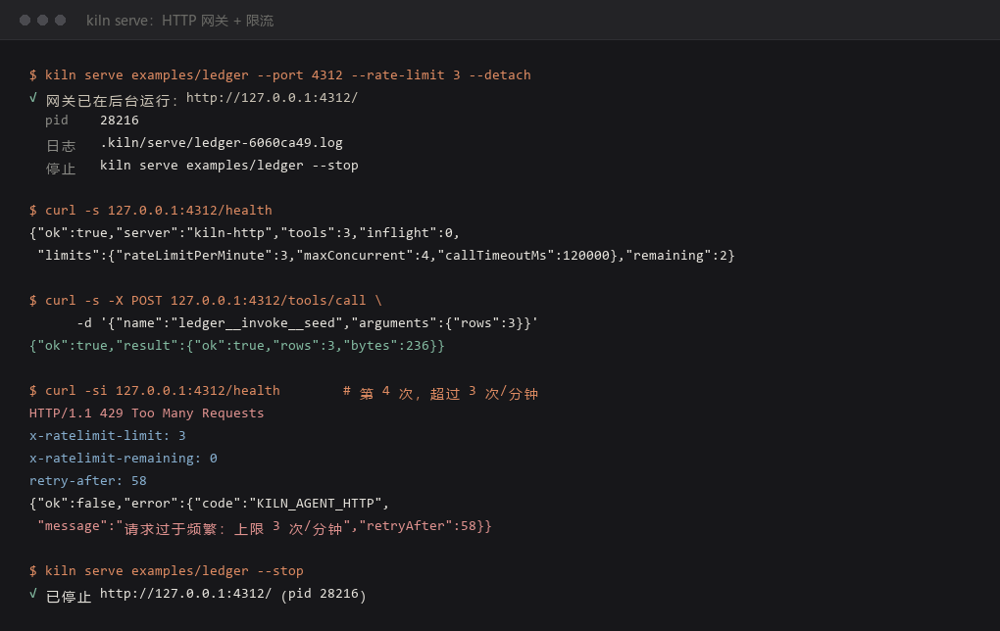
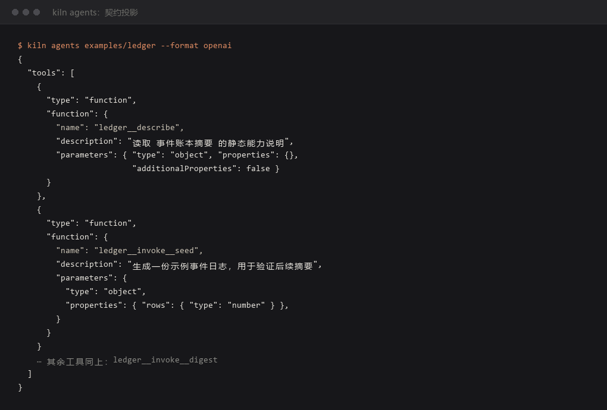

# 接入任意 agent

Kiln 不假设你用什么 agent。只要对方满足下面任意一条，就能接入：

| 对方能力       | 接入方式       | 命令                                            |
| -------------- | -------------- | ----------------------------------------------- |
| 支持 MCP       | MCP stdio      | `kiln mcp <dir>`                                |
| 能发 HTTP      | 通用 HTTP 网关 | `kiln serve <dir>`                              |
| 与 Kiln 同进程 | `AgentBridge`  | `import { createAgentBridge } from "#agents"`   |
| 只想先看契约   | 描述投影       | `kiln agents <dir> --format mcp\|openai\|plain` |

所有方式共用同一份工具命名规则：

```
<cast>__describe          读取能力说明
<cast>__observe           读取当前状态（panel 型）
<cast>__invoke__<tool>    执行一个工具
<cast>__act__<action>     推进一个动作（panel 型，返回最新状态）
```

---

## 一、HTTP（推荐给非 MCP 的 agent）

### 启动

```bash
node packages/surface/src/cli.ts serve ./examples --port 4312 --token dev-secret
# Kiln agent 网关已启动：http://127.0.0.1:4312/
```

| 参数            | 默认      | 说明                                             |
| --------------- | --------- | ------------------------------------------------ |
| `--port`        | 随机      | 监听端口                                         |
| `--host`        | 127.0.0.1 | 需要局域网访问时显式 `0.0.0.0`，并设 token       |
| `--token`       | 无        | 设置后所有请求都要带 Bearer                      |
| `--rate-limit`  | `120`     | 每分钟请求上限，`0` 表示不限                     |
| `--concurrency` | `4`       | 同时执行的调用上限，超出立刻拒绝                 |
| `--timeout`     | `120000`  | 单次调用超时（毫秒），`0` 表示不限               |
| `--detach`      | 关        | 脱离终端后台运行，日志与 pid 落到 `.kiln/serve/` |
| `--stop`        | 关        | 停掉本目录的后台网关                             |

默认只监听 `127.0.0.1`。需要局域网访问时显式 `--host 0.0.0.0`，并务必设置 `--token`。

### 后台运行与停止

```bash
kiln serve ./examples --port 4312 --detach
# ✓ 网关已在后台运行：http://127.0.0.1:4312/
#   pid    28216
#   日志   .kiln/serve/ledger-6060ca49.log
#   停止   kiln serve ./examples --stop

kiln serve ./examples --stop      # 先 SIGTERM，5 秒未退出再 SIGKILL
```

状态文件按「目标目录的绝对路径」稳定映射（`<workspace>/.kiln/serve/<名字>-<hash>.json`），
所以 `--stop` 不需要记端口或 pid。同一目录重复 `--detach` 会被拒绝，避免起两份抢端口。



### 端点

| 方法         | 路径          | 请求                  | 响应                                           |
| ------------ | ------------- | --------------------- | ---------------------------------------------- |
| `GET`        | `/health`     | —                     | `{ ok, server, tools, inflight, limits }`      |
| `GET`/`POST` | `/describe`   | —                     | `{ ok, protocol:"kiln.agent/1", tools }`       |
| `GET`/`POST` | `/tools/list` | —                     | 同上                                           |
| `POST`       | `/tools/call` | `{ name, arguments }` | `{ ok:true, result }` 或 `{ ok:false, error }` |

鉴权：设置 token 后，所有请求需带 `Authorization: Bearer <token>`，否则 401。

### 三道闸门与对应状态码

| 情况                     | 状态码 | 响应体                                      |
| ------------------------ | ------ | ------------------------------------------- |
| 缺 token / token 错      | `401`  | `ok:false` + `KILN_AGENT_HTTP`              |
| 超过每分钟上限           | `429`  | 同上，带 `retry-after` 与 `retryAfter` 字段 |
| 并发已满                 | `429`  | 同上，`message` 说明并发上限                |
| 单次调用超时             | `504`  | 同上，`message` 说明超时毫秒                |
| 业务失败（越权、参数错） | `200`  | `ok:false` + 具体错误码                     |

限流是固定窗口（60 秒），响应头带 `x-ratelimit-limit` / `x-ratelimit-remaining` / `x-ratelimit-reset`。
并发是「立刻拒绝」而不是排队——排队会让 agent 以为调用卡住，反而更难处理。

### 三个 curl（最小可用）

```bash
TOKEN="Authorization: Bearer dev-secret"

curl -s -H "$TOKEN" http://127.0.0.1:4312/health
curl -s -H "$TOKEN" http://127.0.0.1:4312/tools/list
curl -s -H "$TOKEN" -H "content-type: application/json" \
  -d '{"name":"ledger__invoke__add","arguments":{"text":"买牛奶"}}' \
  http://127.0.0.1:4312/tools/call
```

### Python 最小客户端

```python
import json, urllib.request

BASE = "http://127.0.0.1:4312"
HEAD = {"authorization": "Bearer dev-secret", "content-type": "application/json"}

def call(name, arguments):
    body = json.dumps({"name": name, "arguments": arguments}).encode()
    req = urllib.request.Request(f"{BASE}/tools/call", data=body, headers=HEAD, method="POST")
    with urllib.request.urlopen(req) as resp:
        data = json.loads(resp.read())
    if not data["ok"]:
        raise RuntimeError(data["error"])
    return data["result"]

print(call("ledger__invoke__add", {"text": "买牛奶"}))
```

### 错误约定

业务失败也返回 HTTP 200，`ok:false`，错误对象形状固定：

```json
{
  "ok": false,
  "error": {
    "code": "KILN_CAP_DENIED",
    "message": "能力 net 被拒绝",
    "hint": "检查 cast.json 的 grants 与宿主策略",
    "docs": "docs/ERRORS.md#kiln_cap_denied"
  }
}
```

agent 应读 `code` / `hint` 修正，而不是根据 HTTP 状态码猜。

---

## 二、MCP（Claude Desktop / Cursor / 其他 MCP 客户端）

```bash
node packages/surface/src/cli.ts mcp ./examples --workspace .
```

生成的工具名即上面四条规则。`one/kiln-up.mjs` 会自动把这条命令写进已安装客户端的配置，并保留一份可导入的 `.mcp.json`。

---

## 三、进程内（自己写宿主编排）

```ts
import { createAgentBridge } from "#agents";

const bridge = createAgentBridge([{ catalog, runner }], "my-host");

for (const tool of await bridge.listTools()) {
  console.log(tool.name, tool.description, tool.readOnly);
}

const value = await bridge.callTool("ledger__invoke__add", { text: "买牛奶" });
```

`bridge` 不进序列化边界，适合嵌入你自己的主程序。

---

## 四、描述格式（先看再调）

```bash
kiln agents ./examples/ledger --format plain    # kiln.agent/1 自描述
kiln agents ./examples/ledger --format openai   # OpenAI function-calling 数组
kiln agents ./examples/ledger --format mcp      # MCP tools/list 载荷
```

- `openai` 可直接塞进 `tools` 字段，配合任意兼容端点做函数调用。
- `plain` 适合喂给「读 JSON 自己决定怎么调」的 agent。
- `mcp` 适合自建 MCP 客户端或检查工具表。



---

## 五、授权与安全

- 工具能做什么由 `cast.json` 的 `grants` 决定；宿主策略再取一次交集，取更严的那个。
- 越权调用会被拒绝并记账，cast 无法把拒绝吞成业务结果。
- 暴露到非本机前，务必设置 `--token`，并只暴露必要的 cast 目录。
- 不要对不可信 cast 开启 `grants.agent.allow`（那等于允许模型代理调用它的工具）。
