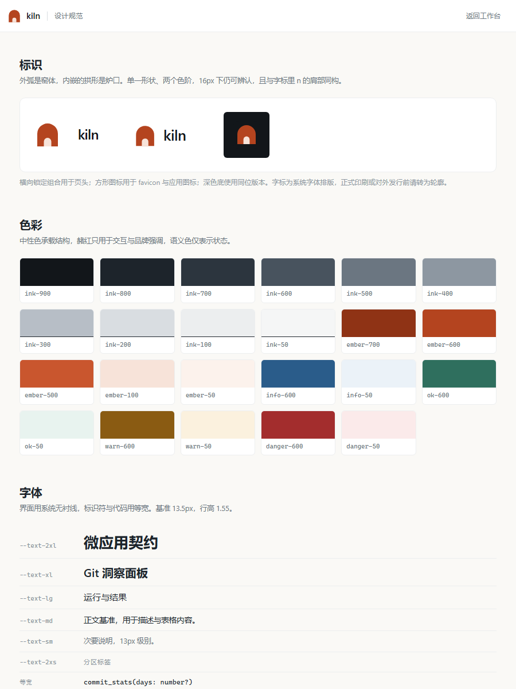

# 品牌与界面规范

所有视觉决定都有唯一出处：颜色、字号、间距写在 [`packages/studio/web/tokens.css`](../packages/studio/web/tokens.css)，组件样式写在 `ui.css`。**不要在任何页面里硬编码色值**，加令牌再加类。

在线查看：`npm run studio` 后打开 `/design`。

## 标志

外弧是窑体，内嵌的拱形是炉口。两个形状、两个色阶，没有第三条线。

| 文件                             | 用途                             |
| -------------------------------- | -------------------------------- |
| `assets/brand/kiln-mark.svg`     | 透明底标志，用于文档、页头       |
| `assets/brand/kiln-wordmark.svg` | 字标，可单独使用                 |
| `assets/brand/kiln-logo.svg`     | 横向锁定（标志 + 字标）          |
| `assets/brand/favicon.svg`       | 深底方形图标，favicon 与应用图标 |

**用法**

- 最小尺寸：标志 16px，横向锁定 高度不低于 24px。
- 留白：标志四周至少留 `0.25 × 标志高度`。
- 深色底使用 `favicon.svg`（本身就是深底版本），不要给透明标志加深色描边。

**禁止**

- 拉伸变形、旋转、加投影或描边。
- 改色（只用 `--ember-600` 与 `--ember-100` 两档）。
- 在杂色照片上直接叠加。
- 字标替换为其他字体后仍作为官方标识使用——正式发行前请把字标转为轮廓（见下）。

> 字标目前是系统字体排版，便于任何人直接使用源文件。对外印刷或商标注册前，请用授权字体把 `kiln` 转为路径，替换 `kiln-wordmark.svg` 与 `kiln-logo.svg` 中的 `<text>`。

## 色彩

三组，各有明确职责，不交叉。

**中性色**（`--ink-*`）：承载结构与文字层次。`900` 标题、`800` 正文、`500` 次要、`400` 标签、`200/100` 分隔线。

**品牌色**（`--ember-*`）：只用于主操作、当前选中态、品牌标识。`600` 是主色，`50/100` 是同色系浅底。

**语义色**：只表示状态，不做装饰。

| 令牌           | 值        | 用途                 |
| -------------- | --------- | -------------------- |
| `--ember-600`  | `#B4441F` | 主按钮、激活态、标志 |
| `--info-600`   | `#2A5C8A` | `invoke` 动词        |
| `--ok-600`     | `#2F6F5E` | `observe` 动词、成功 |
| `--warn-600`   | `#8A5B12` | 警告                 |
| `--danger-600` | `#A32D2D` | 失败、拒绝           |

### 动词配色是固定映射

四个动词的颜色不可复用给其他语义，反之亦然：

| 动词       | 颜色          | 理由                   |
| ---------- | ------------- | ---------------------- |
| `describe` | 中性 `ink-50` | 只是说明，不产生副作用 |
| `invoke`   | 蓝 `info`     | 一次调用，无状态       |
| `observe`  | 绿 `ok`       | 只读                   |
| `act`      | 赭红 `ember`  | 会改变状态，需要留意   |

## 字体

- 界面：`ui-sans-serif` 系统栈，含 `PingFang SC` / `Microsoft YaHei` 兜底中文。
- 代码与标识符：`ui-monospace` 栈。
- 基准 13.5px / 行高 1.55；正文不超过 62 个字符宽。

| 令牌         | 值     | 用途                                           |
| ------------ | ------ | ---------------------------------------------- |
| `--text-2xl` | 26px   | 页面主标题                                     |
| `--text-xl`  | 20px   | 区块标题                                       |
| `--text-lg`  | 15px   | 卡片标题、品牌名                               |
| `--text-md`  | 13.5px | 正文基准                                       |
| `--text-sm`  | 12.5px | 次要说明                                       |
| `--text-xs`  | 12px   | 代码、表格                                     |
| `--text-2xs` | 11px   | 全大写标签（唯一允许 `letter-spacing` 的地方） |

字重只用 400 与 600。不用 500 做正文，不用 700 做标题——粗体一多，层次就靠喊。

## 间距

4px 基准，七级：`4 / 8 / 12 / 16 / 24 / 32 / 48`。

- 组件内部用 1–3 级
- 组件之间用 3–4 级
- 区块之间用 5–6 级
- 页面留白用 6–7 级

不要出现 `13px`、`18px` 这类不在刻度上的值。

## 圆角与层次

- `--radius-sm` 6px：输入框、按钮、小卡片
- `--radius-md` 10px：面板
- `--radius-lg` 14px：独立浮层
- `--radius-full`：标签、计数气泡

层次只用两道阴影 + 一条 1px 分隔线。不用渐变、不用毛玻璃、不用多层投影。

## 组件约定

- **按钮**：一个视图里只有一个 `--primary`。次要操作用默认样式，第三级用 `--ghost`。
- **表格**：第一列是标识符（等宽），最后一列是参数（等宽、不换行）。示例块可横向滚动，不换行折断。
- **标签**：高度 20–22px，圆角全满。超过 4 个标签换行，不缩字号。
- **空状态**：一句说明 + 可选图标，不给假数据。
- **输出块**：深底 `--ink-900` + 浅字，只用于承载机器输出。

## 无障碍

- 正文对比度 ≥ 4.5:1（`--ink-800` on `--paper` 约 11:1）。
- 所有交互元素有可见 `:focus-visible` 环（`--ring`）。
- 不只靠颜色传达状态：动词同时有文字标签。
- 不用小于 11px 的字。

## 改动流程

改视觉 → 改 `tokens.css` 或 `ui.css` → 打开 `/design` 自查 → 截图放进合并请求。

当前设计规范页截图：

新增组件时同时在 `/design` 页加一节展示，否则下一个人不知道它长什么样。
