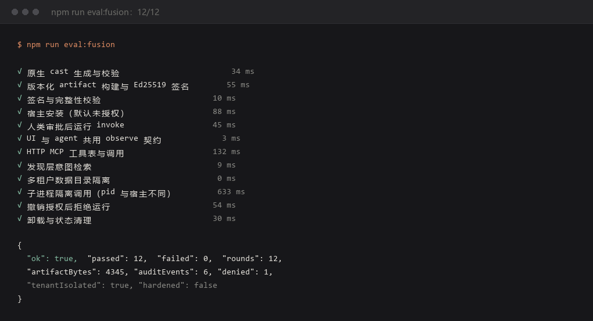

# 融合层：从契约内核到可移植应用供应链

> 定位、取舍与验收标准见 [INTEGRATION-PLAN.md](./INTEGRATION-PLAN.md)。评测报告由开发仓库的 `npm run eval:fusion` 生成（生成物不入库）。

## 1. 解决的问题

Kiln 原先只有「契约内核 + 一键包」。融合层不复制任何外部框架，而是提供一条**可移植的应用供应链**：用 `kiln cast init` 生成 Kiln 原生 cast，产出带签名的版本化 artifact，在宿主里安装审批与呈现，被任意 MCP agent（stdio / HTTP / SSE）调用，最后可撤销与卸载。

```
原生 cast ──kiln cast init──> cast 源码 ──artifact──> 签名交付包
                                                    │
                              ┌─────────────────────┼────────────────────┐
                              ▼                     ▼                    ▼
                        宿主生命周期          HTTP / SSE MCP        发现层 / 多租户
                        （安装·审批·UI）      （远程·多设备）        （意图检索·隔离）
                              └──────────── 统一审计与能力网关 ───────────┘
```

## 2. 模块与能力

| 阶段            | 实现                                                                                                                   | 主要 API / 命令                                                  |
| --------------- | ---------------------------------------------------------------------------------------------------------------------- | ---------------------------------------------------------------- |
| P2 artifact     | 规范化序列化、逐文件 sha256、版本与兼容声明、可复现摘要、安全解包                                                      | `kiln artifact build\|verify\|import\|sign`                      |
| P3 cast 脚手架  | `kiln cast init` 生成原生 cast 源码、`kiln cast check` 校验契约，错误码映射，零外部依赖                                | `kiln cast init\|check`                                          |
| P4 宿主生命周期 | install / update / approve / deny / enable / disable / run / panel / uninstall，UI 与 agent 共用 `observe` / `act`     | `kiln host …`                                                    |
| P5 可信与安全   | Ed25519 签名与验签、JSONL 审计回放、子进程隔离执行、超时与环境变量白名单、`model` / `agent` 离线驱动、`service` 型入口 | `kiln keygen`、`--require-signature`、`--isolated`、`--hardened` |
| P6 远程与评测   | HTTP JSON-RPC + SSE MCP 端点、Bearer 令牌、跨宿主任务链评测                                                            | `kiln mcp-http`、`kiln eval`、开发仓库 `npm run eval:fusion`              |
| P7 发现与租户   | 字符 n-gram 向量 + 关键词混合检索、按租户隔离数据目录                                                                  | `kiln discover`、`--tenant`                                      |

### artifact 格式

`*.kiln.json` 是自描述 JSON：清单原文、全部源码文本、逐文件哈希、`compatibility`、可选 Ed25519 `signature`。摘要对「去掉签名后的规范化 JSON」计算，因此同一目录内容在任何机器上得到同一摘要。`verify` 一次报告全部结构、哈希、版本与签名问题；`import` 拒绝路径穿越。

### 安全边界

- **签名**：`kiln keygen` 生成 Ed25519 密钥（私钥不入库），宿主可用 `--require-signature` 强制验签。
- **审批**：安装后的应用默认为 `installed`，必须显式 `approve` 才能运行；`deny` 立即收回，拒绝事件写入审计。
- **审计**：`.kiln/audit.jsonl` 记录安装、审批、调用、拒绝、卸载，可用 `kiln host audit` 回放。
- **隔离**：`--isolated` 或 `host run --isolated` 在独立子进程执行 cast，宿主内存不受影响；带超时、输出限制与环境变量白名单。`--hardened` 会尝试启用 Node 权限模型，运行时不支持时自动回退为普通子进程隔离，并在评测报告中标注。
- **仍是限制**：进程隔离不等于操作系统沙箱。同机同用户下，恶意代码若主动 `import("node:fs")` 仍可能绕过能力网关；运行完全不可信的第三方代码仍需容器或 OS 级隔离（见 [SECURITY.md](../SECURITY.md)）。

### service 型入口

`entry.kind: "service"` 的 cast 不加载本地模块，`entry.module` 为完整 URL，四动词经 `ctx.cap.net` 转发，访问范围由 `grants.net` 白名单与宿主策略共同决定。

### model / agent 能力

`createModelDriver` / `createAgentDriver` 提供可插拔驱动：默认离线、只返回结构化结果，不发起外部调用；宿主可注入自定义处理器。`agent` 驱动强制限制 `maxTurns ≤ 8`。

## 3. 命令示例

```bash
# 生成密钥 → 构建签名 artifact
kiln keygen --key-dir .kiln/keys --json
kiln artifact build examples/ledger --out dist/ledger.kiln.json --key <keyId> --json
kiln artifact verify dist/ledger.kiln.json --key-dir .kiln/keys --require-signature --json

# Kiln 原生 cast
kiln cast init ./my-project --json
kiln cast check ./my-project --json

# 宿主生命周期
kiln host install dist/ledger.kiln.json --require-signature --json
kiln host approve ledger --by 维护者 --json
kiln host run ledger --verb invoke --name seed --args '{"rows":8}' --json
kiln host panel ledger --json
kiln host audit --json
kiln host uninstall ledger --json

# 远程与发现
kiln mcp-http examples --port 4312 --token <令牌>
kiln discover "日志 摘要" --dir examples --json

# 隔离与评测
kiln invoke examples/ledger seed --args '{"rows":8}' --isolated --json
kiln eval --json
```

> 文档中的 `dist/` 仅为示例输出路径，项目本身仍保持「构建不打包运行时」的约束。

## 4. 验收

`test/fusion.spec.ts` 覆盖 artifact 可复现/篡改拒绝/验签/解包、原生 cast 脚手架、宿主全生命周期与审批拒绝、审计回放、子进程隔离、HTTP MCP 与 SSE、Bearer 鉴权、发现层、多租户、离线驱动、service 入口、跨宿主评测全通过，以及仓库卫生（无临时文件、无孤立图片、无失效相对链接、一键包无运行时产物）。

开发仓库的 `npm run eval:fusion` 会在 `docs/FUSION-REPORT.md` 生成评测报告，给出任务通过率、耗时、artifact 体积、审计事件数与隔离标志；该文件是生成物，不随仓库分发。



## 5. 明确未做

- 未把任何外部框架的构建链或运行时搬进仓库；脚手架与宿主生命周期只依赖 Kiln 自身与标准协议（HTTP/SSE MCP）。
- 未在真实第三方 MCP 客户端 UI 中做人工端到端验收；当前验证的是协议互操作与本地模拟宿主。
- 未实现应用市场的服务端、计费与远程身份体系。
