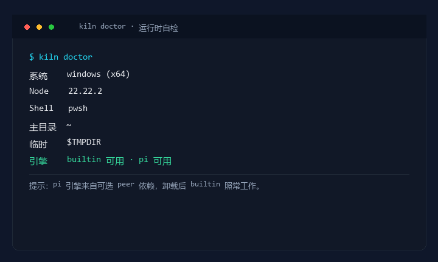

# 跨平台与运行环境

Kiln 的目标是「同一份源码，在 Windows / macOS / Linux 上行为一致」。差异被收拢到 `packages/platform`，其余模块只消费归一化后的结果。

## 一眼看懂

```bash
node packages/surface/src/cli.ts doctor            # 人类可读
node packages/surface/src/cli.ts doctor --json     # 机器可读
```

输出包含：OS、架构、Node 版本与是否达标、Shell、家目录、临时目录、路径分隔符，以及两个 coding agent 引擎的可用性。



## 平台差异清单

| 关注点     | Windows                 | macOS / Linux                                                       | 处理方式                                            |
| ---------- | ----------------------- | ------------------------------------------------------------------- | --------------------------------------------------- |
| 路径分隔符 | `\`                     | `/`                                                                 | `normalizePath()` 统一成 `/`；判断绝对路径兼容盘符  |
| 默认 shell | `ComSpec`（cmd.exe）    | `$SHELL`，兜底 zsh/sh                                               | `detectShell()`                                     |
| 家目录     | `USERPROFILE`           | `HOME`                                                              | `KILN_ONE_HOME → HOME → USERPROFILE → os.homedir()` |
| 文件占用   | 索引/杀软会短暂 `EBUSY` | 少见                                                                | store 写入短重试                                    |
| 子进程     | 需 `windowsHide`        | —                                                                   | `execFile(..., { windowsHide: true })`              |
| 后台进程   | `kill()` 直接结束       | `SIGTERM` 可被捕获                                                  | `stopProcess()` 先礼后兵，两步都试                  |
| 客户端配置 | `%APPDATA%\Claude\...`  | `~/Library/Application Support/Claude/...` / `~/.config/Claude/...` | `one/clients.ts` 分别解析                           |

## 后台进程（`platform/daemon.ts`）

`kiln serve --detach/--stop` 依赖这一层，它只做四件事：状态文件、存活探测、优雅停止、脱离终端启动。

| 函数                                | 平台细节                                                      |
| ----------------------------------- | ------------------------------------------------------------- |
| `serveStatePath(workspace, target)` | 路径 hash 决定文件名，同一目录永远同一份状态，跨平台一致      |
| `isProcessAlive(pid)`               | `kill(pid, 0)`；`EPERM` 也算活着，避免误判为已退出            |
| `stopProcess(pid, timeoutMs)`       | `SIGTERM` → 轮询 → `SIGKILL`；Windows 上第一步等价于直接结束  |
| `spawnDetached({...})`              | `detached: true` + `windowsHide: true` + `stdio` 重定向到日志 |
| `waitForFile(file, timeoutMs)`      | 后台进程写完状态文件才算「就绪」，避免父进程提前报成功        |

## 运行环境要求

- **Node ≥ 22.18**：这是硬门槛，因为 Kiln 直接运行 `.ts`（依赖 Node 内置类型擦除），从而做到「无构建、零依赖」。
- 低于该版本时：
  - `kiln doctor` 退出码为 `1`，并明确提示需要的版本；
  - 其他命令可能在加载阶段报语法错误。请先升级 Node。
- **无原生模块**：不需要编译工具链，不需要 Python/gyp。
- **无网络安装**：`npm install` 只拉 `typescript` / `prettier` / `@types/node`。

## 编码与流

- 全程 UTF-8；读写显式指定 `utf8`。
- MCP 按行读取，`crlfDelay: Infinity`，CRLF / LF 都能处理。
- HTTP 网关请求体上限 4 MB，超出返回 500 与结构化错误。

## 环境变量

| 变量                                      | 作用                                         |
| ----------------------------------------- | -------------------------------------------- |
| `KILN_HOME`                               | 运行时根目录（一键包查找仓库时使用）         |
| `KILN_ONE_HOME`                           | 覆盖家目录探测（测试/自定义部署）            |
| `KILN_ONE_CLIENTS`                        | 指定要注册的客户端（`auto` / `none` / 列表） |
| `KILN_ONE_CLIENT_CONFIG`                  | 自定义客户端配置文件路径（多个用路径分隔符） |
| `KILN_TENANT`                             | 多租户数据目录隔离                           |
| `KILN_MODEL_BASE_URL` / `KILN_MODEL_NAME` | coding agent 的默认端点与模型                |

## 部署形态

| 形态     | 命令                                   | 适用                       |
| -------- | -------------------------------------- | -------------------------- |
| 源码直跑 | `node packages/surface/src/cli.ts ...` | 开发、审计、无安装         |
| 全局命令 | `npm install -g .` 后 `kiln ...`       | 日常使用                   |
| 本机网关 | `kiln serve <dir> --port ...`          | 多 agent / 多语言共用      |
| 一键包   | `node one/kiln-up.mjs`                 | 普通用户，自动写客户端配置 |

数据只在 `--workspace` 下的 `.kiln/`，复制该目录即完成迁移，不写系统目录、不写注册表（除非显式开启开机自启）。
