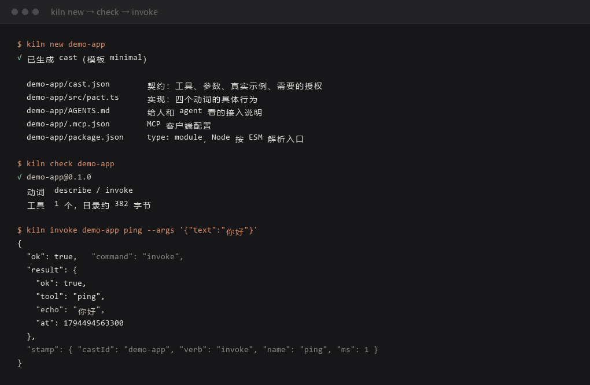
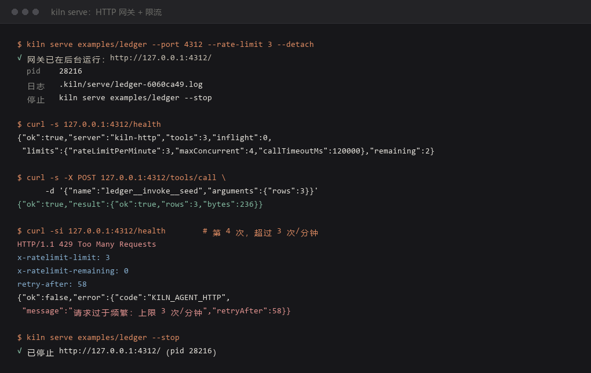
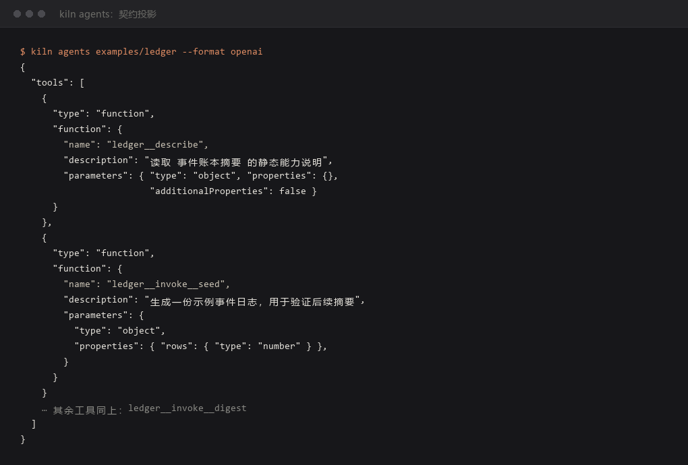

# 15 分钟跑通

从零到「agent 能调你的工具」，只需要四条命令。下面所有输出都是真实运行结果。

## 0. 前置

Node ≥ 22.18（Kiln 直接运行 `.ts`，靠的是 Node 内置类型擦除，所以没有构建步骤）：

```bash
node -v      # v22.18.0 及以上
kiln doctor  # 顺手确认一下系统、Node、引擎
```

还没装 `kiln` 命令时，用仓库里的入口，效果完全一样：

```bash
node packages/surface/src/cli.ts doctor
```

想装成全局命令：`npm install -g .`，之后 `kiln ...` 就能用。

## 1. 生成一个项目（30 秒）

```bash
kiln new demo-app
```



生成的是**能直接跑**的 cast，不是一堆待填的 TODO：

| 文件           | 作用                                    |
| -------------- | --------------------------------------- |
| `cast.json`    | 契约：工具、参数、真实示例、需要的授权  |
| `src/pact.ts`  | 实现：四个动词的具体行为                |
| `AGENTS.md`    | 给人和 agent 看的接入说明               |
| `.mcp.json`    | MCP 客户端配置，可直接导入              |
| `package.json` | `type: module`，让 Node 按 ESM 解析入口 |
| `README.md`    | 这个 cast 怎么跑、改哪里                |

三套模板，按需选：

```bash
kiln new demo-app                      # minimal：一个工具，最小闭环
kiln new notes --template toolkit      # toolkit：带持久化的键值小工具
kiln new board --template panel        # panel：有状态、可 observe / act
```

## 2. 校验并试跑（1 分钟）

```bash
kiln check demo-app
kiln describe demo-app
kiln invoke demo-app ping --args '{"text":"你好"}'
```

`check` 会**一次报出所有问题**，而不是遇到第一个就退出：清单里声明的工具必须和 `pact.ts` 里实现的一一对应，示例入参必须符合参数类型。改完再跑一次，直到看到 `✓`。

`invoke` 返回结构化结果，带 `stamp`（哪次调用、哪个动词、耗时多少）。

## 3. 接进 agent（3 分钟）

三条路，任选一条：

**支持 MCP 的客户端**（Claude Desktop / Cursor 等）：

```bash
kiln mcp demo-app --workspace .
```

工具名形如 `demo-app__invoke__ping`。

**只能发 HTTP 的 agent**（任何语言）：

```bash
kiln serve demo-app --port 4312 --token dev-secret --detach
curl -s -H "Authorization: Bearer dev-secret" http://127.0.0.1:4312/tools/list
kiln serve demo-app --stop          # 用完停掉
```



**只想先看契约**：

```bash
kiln agents demo-app --format openai    # 直接塞进 tools 字段
kiln agents demo-app --format plain     # 喂给「读 JSON 自己决定怎么调」的 agent
kiln agents demo-app --format mcp       # MCP tools/list 载荷
```



## 4. 写成自己的工具（10 分钟）

打开 `demo-app/src/pact.ts`，加一个工具，再回 `cast.json` 同步声明。以「查询天气」为例：

```ts
// src/pact.ts
async invoke(tool: string, args: Record<string, unknown>, ctx: any) {
  if (tool === "ping") return { ok: true, tool, echo: args.text ?? null, at: Date.now() };

  if (tool === "weather") {
    const city = String(args.city ?? "");
    if (city === "") return { ok: false, reason: "缺少 city" };
    const res = await ctx.cap.net(`https://example.com/weather?city=${encodeURIComponent(city)}`);
    return { ok: true, city, status: res.status, body: res.body.slice(0, 200) };
  }

  return { ok: false, reason: `未实现工具: ${tool}` };
}
```

```json
// cast.json 的 tools 里加一条，并在 grants 里放行对应的域名
{
  "name": "weather",
  "purpose": "查询某个城市的天气",
  "args": { "city": "城市名" },
  "returns": "{ ok, city, status, body }",
  "examples": [{ "call": { "city": "上海" }, "result": { "ok": true, "city": "上海", "status": 200 } }]
}
```

```json
"grants": { "net": { "allow": ["example.com"] } }
```

**关键约束**：cast 里不能直接 `fetch`、不能 `require("fs")`。一切外部访问都走 `ctx.cap`（`shell` / `net` / `file` / `store`），宿主才拦得住越界、才记得下账。这是 Kiln 与「随便写个脚本」的唯一本质区别。

改完跑：

```bash
kiln check demo-app                     # 声明与实现是否对得上
kiln invoke demo-app weather --args '{"city":"上海"}'
kiln audit --limit 5                    # 刚才那次调用记在账上了
```

## 常见卡点

| 现象                                    | 原因与处理                                                     |
| --------------------------------------- | -------------------------------------------------------------- |
| `KILN_MANIFEST_FIELD`                   | `cast.json` 少了必填字段，或 `id` 不是小写字母开头             |
| `KILN_PACT_MISMATCH`                    | 声明的工具没实现，或实现了没声明；`detail` 会列出多出与缺少的  |
| `KILN_SHAPE_MISMATCH`                   | `shape: panel` 必须同时有 `observe` 与 `act`                   |
| `SyntaxError: Unexpected token ':'`     | Node 版本低于 22.18，不支持类型擦除。升级 Node                 |
| `ERR_PACKAGE_IMPORT_NOT_DEFINED: #pact` | 生成的入口不要 import 仓库内别名；`kiln new` 已默认不 import   |
| 调用返回 `KILN_CAP_DENIED`              | `grants` 没放行，或宿主策略更严。看 `hint` 里差哪个能力        |
| `kiln serve` 起来但外部连不上           | 默认只监听 `127.0.0.1`；需要时 `--host 0.0.0.0` 并设 `--token` |
| 请求返回 `429`                          | 触发限流或并发上限。看 `retry-after`，或调大 `--rate-limit`    |

## 下一步

- 想让模型自己调工具：[内置 coding agent](CODING-AGENT.md)
- 想搞懂四动词： [契约](PACT.md)
- 想接别的客户端：[接入任意 agent](AGENTS.md) · [融合层](FUSION.md)
- 想部署到别的机器：[跨平台](PLATFORM.md) · [独立化与验收](STANDALONE.md)
